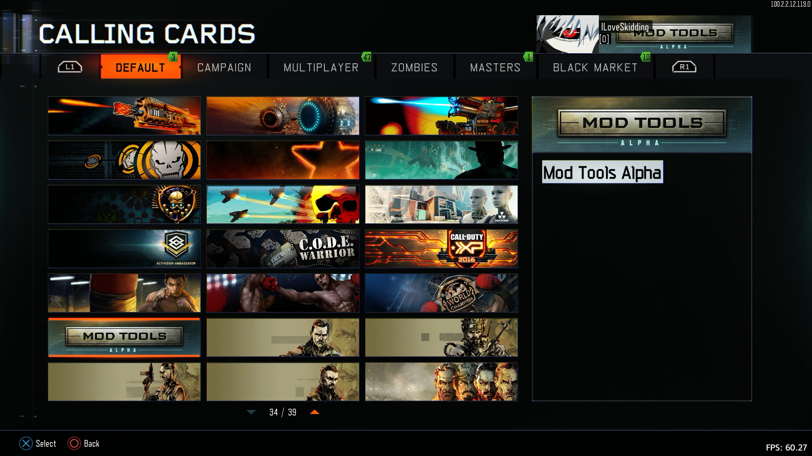

# Black Ops 3 Entitlements Hard Unlock for PS4

This is the source code for the Black Ops 3 entitlements unlock. It writes category 5 keys 1 to 25, including the Mod Tools calling card.

## In-game screenshot

This shows the Mod Tools Alpha calling card in the Black Ops 3 calling cards menu.



## What it does

The PRX changes the entitlement archive in the running game process. Changes are made to local runtime state. Persistence and server-side behavior depend on the game build and service, and have not been tested by this project.

## Requirements

You’ll need Windows and the .NET 8 SDK to build the RTM tool. To build the PRX, you’ll also need Visual Studio with the Sony ORBIS SDK set up.

This project targets one specific Black Ops 3 PS4 build, title ID CUSA02624. The offsets in `prx/bo3_offsets.h` may not work with another region or game update. The code uses a fixed game address and does not include ASLR support, so make sure your game matches the build these offsets came from.

The Sony SDK and `make_fself.exe` are not included. If you have your own copy of `make_fself.exe`, put it in `dependencies/self/make_fself.exe`. This converts the built PRX into an SPRX. If you don’t have it, the PRX can still build, but it won’t create the SPRX file.

## How to build

To build the RTM tool, open PowerShell in this folder and run:

```powershell
dotnet build .\rtm\Bo3Rtm.csproj -c Release
```

To build both projects, open `bo3-entitlements.sln` in Visual Studio and build the Release configuration. You can also open a Visual Studio Developer PowerShell with the ORBIS SDK set up, then run:

```powershell
.\build.ps1
```

The RTM tool will be in `rtm\bin\Release\net8.0-windows\`. The PRX build creates a PRX file. It also creates an SPRX if `make_fself.exe` is in the folder mentioned above.

## How to use it

Build the tool and PRX for the matching game build. Load the SPRX using your console’s plugin setup. Start Black Ops 3 and the RTM tool, enter your console’s IP address, and connect. Select **Check build** first. If the check passes, select **Write entitlements**.

The RTM tool asks you to confirm before sending the write command. This has not been checked on every game update or console setup, so make sure your game build matches before using it.


